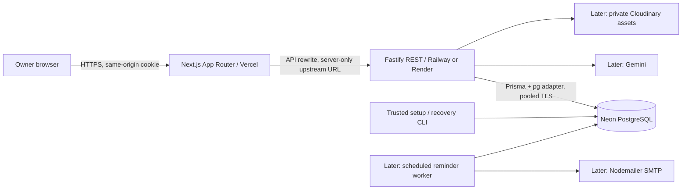

# TaskMate AI architecture and implementation contract

## Scope and delivery

This repository replaces neither the existing Macha static site nor its browser data. It is a separate application using the requested stack. Phase 1 is the current implementation boundary; phases 2–6 are explicitly planned, not simulated. Production deployments target Vercel + Railway/Render + Neon, rather than the Cloudflare-based Sites hosting runtime, because the requested Node/Fastify/PostgreSQL architecture must be preserved.

## System architecture



Only `/healthz`, CORS preflight, and the rate-limited login route bypass session authentication. The backend authorizes all other routes, including OpenAPI and unknown API paths. Frontend route-group layout also validates the cookie server-side. The browser never receives the database or provider credentials.

## Final folder structure

```text
taskmate-ai/
  frontend/
    src/app/(auth)/login/
    src/app/(workspace)/{dashboard,settings}/       # present
    src/app/(workspace)/{tasks,notes,calendar,assistant,productivity,
                         expenses,bookmarks,learning,journal,projects,files}/ # later
    src/components/{ui,layout,shared}/
    src/features/{auth,dashboard,settings}/        # extend per phase
    src/{hooks,lib,store}/
    tests/
  backend/
    prisma/{schema.prisma,migrations}/
    src/config/
    src/plugins/
    src/modules/{auth,settings,dashboard,notifications}/
    src/modules/{tasks,notes,calendar,reminders,ai,productivity,
                 expenses,bookmarks,learning,journal,projects,files}/ # later
    src/{services,utils,cli}/
    src/jobs/                                    # phase 2 worker
    tests/
  docs/{ARCHITECTURE,API_PLAN,MODEL_PLAN,DEPLOYMENT,PHASE_1}.md
```

Each module groups schemas, routes/handlers, services and types. Data-access code stays outside route definitions. No speculative empty module files are created. Strict TypeScript applies to both packages. Dependencies are lockfile-pinned. The UI uses shadcn-compatible owned Radix Button/Dialog components, Tailwind v4 tokens, Lucide icons, reduced-motion-aware Motion transitions, RHF/Zod forms, TanStack Query for server state and Zustand only for the mobile navigation state. Tiptap, FullCalendar, Recharts and provider SDKs are installed when their actual module is implemented, avoiding unused runtime dependencies.

## Authentication and security

- Owner initialization is a trusted CLI operation. Unique `ownerSlot` plus a SQL `CHECK(ownerSlot = 1)` prevents a second owner even through raw SQL. No signup endpoint exists.
- Passwords use bcrypt cost 12, minimum 12 characters, maximum 72 UTF-8 bytes. Login supports case-normalized email or username. Unknown identifiers receive a dummy bcrypt comparison and the same generic rejection.
- JWTs use HS256, a random environment secret, issuer/audience checks and 5–30 minute expiry (15 default). Every request verifies the database session, owner ID and database expiry. Session IDs are UUIDs. No persistent refresh token is issued in Phase 1; expiry requires reauthentication.
- The production cookie is `__Host-taskmate`, Secure, HttpOnly, SameSite=Strict, Path=/, without Domain. Local HTTP uses `taskmate_session` without Secure. Logout deletes the session; password changes/recovery delete every owner session. Login checks for a password change racing with session creation.
- Every mutation checks the exact Origin, including login. Authenticated mutations also require a random session-bound CSRF token obtained from `/auth/me`. GET routes have no side effects. Responses are `no-store`.
- Tight CORS allowlist, Helmet, request/body limits, no implicit proxy trust, IP rate limiting and persistent owner lockout after five failures. Deployment is initially one API instance; a shared Redis rate-limit store is needed before horizontal scaling. Persistent lockout remains database-backed.
- Safe structured errors omit query/secret details. Request bodies, cookies and credentials are not logged. Rich user text is rendered as React text. No raw HTML rendering, public uploads, or URL-fetching endpoints are introduced in Phase 1.
- Recovery requires trusted host/database access and environment credentials; no public reset endpoint or email simulation.
- Frontend CSP permits Next bootstrap inline scripts. A nonce-based CSP is part of the later hardening review; there is no `dangerouslySetInnerHTML` for saved content.

## Data and time

UUID keys, UTC timestamptz values and owner-scoped indexes form the base. Dashboard boundaries use the owner's IANA timezone and handle DST. Money is stored as Decimal(18,2); aggregate values travel as decimal strings. File bytes use BigInt and travel as strings. The dashboard performs a coherent read transaction with bounded result sets and no demo data.

## UI component architecture

Root Providers → protected server layout → SessionContext + Workspace shell → feature views. Shared `GlassCard`, `PageHeader`, `StatCard`, `EmptyState`, `LoadingSkeleton`, `FormModal`, and `ConfirmDialog` provide visual consistency. The shell owns navigation search, notification inbox, profile/settings and logout confirmation. Search currently searches available pages; full record search is Phase 2/4/5. Future modules open an explicit roadmap, not fake CRUD screens. Loading, network failure, expired session, empty database, and mobile states are distinct.

## Roadmap and gates

1. Foundation: initialize packages, Prisma migration, owner CLI/recovery, login/logout/password, protected dashboard, preferences, shell and security tests.
2. Core: task/subtask/category/tag CRUD, recurrence and history; Tiptap notes/autosave; FullCalendar; transactional reminder outbox + scheduled worker; global core-record search. Gate: task/note/calendar CRUD tests and worker retry/idempotency tests.
3. AI/productivity: server-side Gemini retrieval with bounded authorized context; validated structured proposals requiring confirmation; conversations; planner/reviews; durable focus sessions, habits/goals and Recharts. Gate: invalid AI response/proposal replay tests and complete requested E2E flow.
4. Personal: Decimal expense/budget/CSV workflows; safe bookmark URLs without unrestricted SSRF fetching; learning; private journal; projects/Kanban and milestones. Gate: calculation, ownership and integration tests.
5. Files: Cloudinary authenticated uploads, file signatures/type/size limits, private signed delivery, reconcile deletions, note/project junctions. Gate: rejected uploads and partial-failure tests.
6. Finalization: full browser regression, accessibility/mobile review, performance/index review, secrets/log/CSP audit, JSON backup and deployment smoke tests. Only then assess production readiness.

Reminder design: a database claim/lease transaction with unique occurrence and delivery keys, retry backoff, durable outbox, worker liveness monitoring and provider idempotency where supported. SMTP has no general exactly-once guarantee: document the send/ack crash window, reuse deterministic Message-ID and reconcile outcomes rather than claim perfect deduplication.

AI design: explicit typed tools, limited retrieval, untrusted content boundaries, no direct mutation. Store proposed changes with owner/expiry/hash and consume an approved proposal exactly once in a transaction. Sensitive journals/files are excluded from retrieval by default until explicitly enabled.

References verified during implementation: [Next.js installation](https://nextjs.org/docs/app/getting-started/installation), [Prisma config](https://docs.prisma.io/docs/orm/reference/prisma-config-reference), [Prisma driver adapters](https://docs.prisma.io/docs/orm/v7/core-concepts/supported-databases/database-drivers), [Fastify LTS](https://fastify.dev/docs/v5.0.x/Reference/LTS/). npm's Prisma `latest` tag pointed to an 8.0 release candidate; Phase 1 deliberately uses stable 7.10.1.
