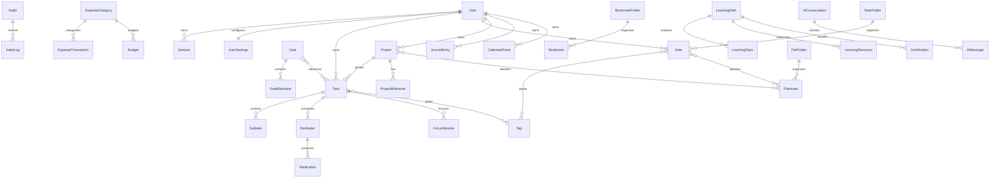

# Entity relationships and Prisma model plan

This is the target design, not a claim that all tables/features are implemented. The initial migration contains User, Session, UserSettings and eight dashboard read-model foundations. Subsequent migrations extend them without resetting owner data.

All personal roots include ownerId; all models get UUID id, createdAt, updatedAt unless an immutable history table has only createdAt. Validate owner membership on linked records and use composite owner/id keys where practical so cross-owner attachment is impossible even if a future migration relaxes the singleton restriction.

| Model                              | Important fields, relationships and constraints                                                                                                                | Phase      |
| ---------------------------------- | -------------------------------------------------------------------------------------------------------------------------------------------------------------- | ---------- |
| User                               | Singleton ownerSlot=1 CHECK + UNIQUE; unique normalized email/username; bcrypt hash, failure counter, lock expiry                                              | 1          |
| Session                            | owner FK, expiry index; row existence is revocation authority                                                                                                  | 1          |
| UserSettings                       | Unique owner FK; IANA timezone, ISO currency, theme, durations, reminder/AI preferences                                                                        | 1          |
| Task                               | Owner, title/description, priority/status enums, UTC due/completed dates; later project/category/goal links, recurrence rule, next occurrence, idempotency key | 1 base / 2 |
| Subtask                            | Task FK, title, completed, position; cascade with task                                                                                                         | 2          |
| TaskCategory                       | Owner/name unique, optional color                                                                                                                              | 2          |
| Tag                                | Owner/name unique; explicit TaskTag, NoteTag, BookmarkTag, JournalTag, FileTag junctions                                                                       | 2 onward   |
| TaskCompletion                     | Immutable task ID/time/occurrence history; unique occurrence key prevents double completion                                                                    | 2          |
| Note                               | Owner, title, Tiptap JSON, archive/pin, revision for autosave conflict detection, safe searchable text; folder/task/project links                              | 1 base / 2 |
| NoteFolder                         | Owner/name/parent, unique sibling names; prevent cyclic hierarchy                                                                                              | 2          |
| CalendarEvent                      | Owner/title/description/start/end/timezone/recurrence, CHECK end > start, occurrence override relation                                                         | 2          |
| Reminder                           | Owner/task or event FK, dueAt/status, lease owner/expiry, attempt count, occurrence key UNIQUE, snooze/dismiss timestamps                                      | 2          |
| Notification                       | Owner/title/body/readAt; later reminder FK and unique delivery key                                                                                             | 1 base / 2 |
| DeliveryOutbox                     | Reminder occurrence/channel unique, scheduled/retry/accepted state, provider receipt, attempts                                                                 | 2          |
| AIConversation                     | Owner/title/archive; indexed owner/updatedAt                                                                                                                   | 3          |
| AIMessage                          | Conversation, role, text, token metadata, validated structured proposal; no provider keys                                                                      | 3          |
| AIProposal                         | Owner/conversation, validated JSON, hash, expiry/approved/consumed timestamps, single-use uniqueness                                                           | 3          |
| FocusSession                       | Owner/start/durationSeconds/completed; later task FK, pause ledger, unique client operation ID                                                                 | 1 base / 3 |
| Habit                              | Owner/name, daily/weekly schedule, target frequency/timezone, archive                                                                                          | 3          |
| HabitLog                           | Habit FK, local calendar date; unique habit/date, completion timestamp                                                                                         | 3          |
| Goal                               | Owner/title/target/status; TaskGoal junction; progress derived from milestones                                                                                 | 3          |
| GoalMilestone                      | Goal FK/title/weight/completedAt; cascade with goal                                                                                                            | 3          |
| ExpenseTransaction                 | Owner/kind/Decimal(18,2)/currency/date/memo; later category/payment method/recurrence                                                                          | 1 base / 4 |
| ExpenseCategory                    | Owner/name/kind unique; restrict category deletion while referenced or reassign transaction                                                                    | 4          |
| Budget                             | Owner/category/month/currency, Decimal amount; unique owner/category/month/currency                                                                            | 4          |
| Bookmark                           | Owner/validated http(s) URL/title/description/favorite/folder; no arbitrary server URL fetching                                                                | 4          |
| BookmarkFolder                     | Owner/name/parent; folder delete unfiles bookmarks                                                                                                             | 4          |
| LearningPath                       | Owner/title/target; later skill/course fields, topics and certifications; computed progress                                                                    | 1 base / 4 |
| LearningTopic                      | Path/parent/title/order/completedAt, optional linked task                                                                                                      | 4          |
| LearningResource                   | Path/topic/validated URL/title/type                                                                                                                            | 4          |
| Certification                      | Owner/path/title/issuer/issuedAt/expiry/private file reference                                                                                                 | 4          |
| JournalEntry                       | Owner/local date/Tiptap JSON/mood/reflection/favorite; owner/date index; strictly private                                                                      | 4          |
| Project                            | Owner/title/description/status/start/target; derived task/milestone progress, archive                                                                          | 1 base / 4 |
| ProjectMilestone                   | Project/title/dueAt/completedAt, position                                                                                                                      | 4          |
| FileAsset                          | Owner/name/unique Cloudinary publicId/resourceType/MIME/BigInt bytes; later folder/tags/status/version/deliveryType                                            | 1 base / 5 |
| FileFolder                         | Owner/name/parent; cycle check, unfile assets on folder delete                                                                                                 | 5          |
| NoteAttachment / ProjectAttachment | Explicit unique note/file or project/file pair, owner-safe relations, cascade junctions only                                                                   | 5          |

Use owner-scoped composite indexes for status/date/search access. Add PostgreSQL full-text GIN indexes in the notes/search migration. Deleting records removes owned children or junction rows, never provider assets silently: file deletion uses an explicit reconciliation state before metadata removal. User deletion is not exposed by an API. Financial records require positive amounts; income/expense sign is modeled by the enum, not float math. Store recurrence timezone alongside UTC instants; expand bounded occurrence windows in the worker.
